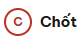
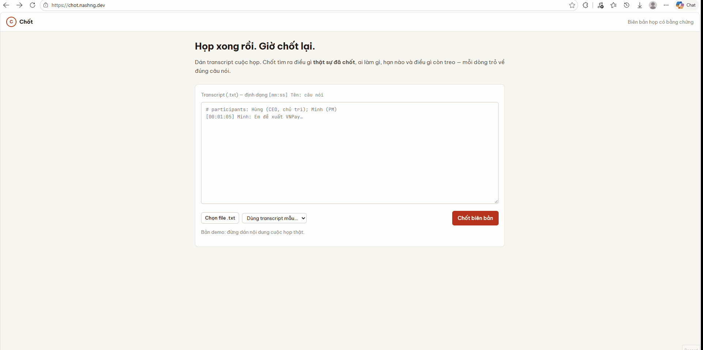
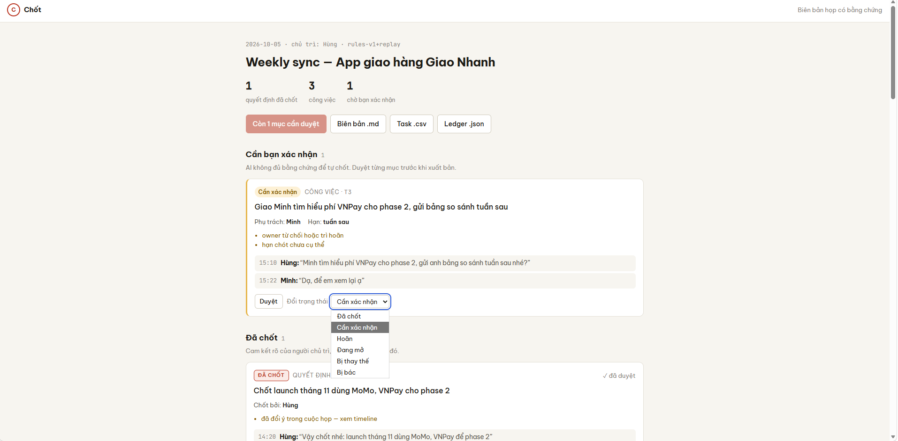
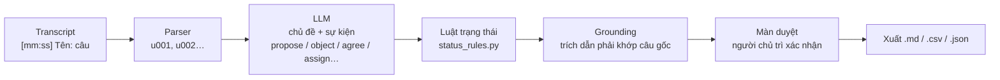

<div align="center">



# Chốt

**Biên bản họp có bằng chứng cho SME Việt Nam.**
Dán transcript → biết ngay điều gì *thật sự đã chốt*, ai làm gì, hạn nào, điều gì còn treo. Mỗi dòng trỏ về đúng câu nói gốc.

[](https://chot.nashng.dev)


[](LICENSE)

 [**Dùng thử demo**](https://chot.nashng.dev) 



</div>

## Mục lục

- [Chốt](#chốt)
  - [Mục lục](#mục-lục)
  - [Vì sao có Chốt](#vì-sao-có-chốt)
  - [Tính năng](#tính-năng)
  - [Kết quả đo](#kết-quả-đo)
  - [Cách hoạt động](#cách-hoạt-động)
  - [Chạy local](#chạy-local)
  - [Sử dụng](#sử-dụng)
  - [Cấu trúc thư mục](#cấu-trúc-thư-mục)
  - [Giấy phép](#giấy-phép)
<!-- - [Tài liệu](#tài-liệu)
- [Đã làm / Chưa làm](#đã-làm--chưa-làm)
- [Deploy](#deploy) -->
- [Giấy phép](#giấy-phép)

## Vì sao có Chốt

Họp dự án hay đi theo kiểu: đầu họp đề xuất A, giữa họp "tạm thời đi B", cuối họp mới chốt hẳn. Biên bản viết tay hoặc AI tóm tắt thường ghi luôn câu "tạm thời" thành quyết định, và cả nhóm làm theo một thứ chưa ai chốt.

> Đầu họp đề xuất VNPay, giữa họp "tạm thời đi MoMo", cuối họp "chốt MoMo, VNPay để phase 2"
> → Chốt ghi **MoMo = Đã chốt**, **VNPay = Bị thay thế**, không có mục "tạm thời" nào bị ghi thành quyết định.

Người dùng: PM / trưởng nhóm SME chủ trì họp dự án định kỳ. Mục tiêu chính: **tỷ lệ chốt nhầm ≤ 5%**.

<p align="right"><a href="#chốt">↑ lên đầu</a></p>

## Tính năng

- **Decision Ledger thay cho bản tóm tắt.** 8 loại mục: quyết định, phương án, công việc, vướng mắc, câu hỏi mở, kiến thức, yêu cầu, phản hồi. Mỗi mục có trạng thái cuối: Đã chốt / Cần xác nhận / Bị thay thế / Hoãn / Đang mở.
- **Giữ kết luận cuối khi ý kiến đổi nhiều lần.** Phương án cũ được giữ ở mục "Bị thay thế", không bị xoá và không bị nhầm thành quyết định.
- **Mọi dòng có bằng chứng.** Bấm vào trích dẫn là nhảy tới đúng câu trong transcript. Trích dẫn không khớp transcript thì mục bị bỏ.
- **Không đoán.** "Tạm thời…", "Dạ, để em xem lại", chủ trì chỉ đáp "Ừ." → đều thành "Cần xác nhận", kèm lý do. Không suy đoán owner, hạn hay người quyết.
- **Người chủ trì duyệt trước khi gửi.** Nút xuất bản bị khoá khi còn mục cần xác nhận. Xuất biên bản `.md`, task `.csv`, ledger `.json`.
- **Hiểu tiếng Việt trộn tiếng Anh** ("em propose…", "budget split", "request của khách").



<p align="right"><a href="#chốt">↑ lên đầu</a></p>

## Kết quả đo

25 cuộc họp có cài bẫy (m01–m25, đều là kịch bản: m01–m05 Nash tự viết, m06–m25 tổng hợp; chưa có họp thật), nhãn gold của Nash, cùng model gpt-4.1-mini.

| Hệ thống | Chốt nhầm ⭐ | Phương án cũ được gắn "bị thay thế" | Precision / Recall mục |
|---|---|---|---|
| Lọc keyword | 57,6% (19/33) | 0% | 87,5% / 20,0% |
| 1 prompt tóm tắt | 54,3% (25/46) | 0% | 81,5% / 33,7% |
| Chốt, chạy đầu-cuối | 4,8% (1/21) | 78,9% | 73,8% / 51,7% |
| Chốt, cùng sự kiện qua luật hiện tại (replay) | **0% (0/20)** | 78,9% | 73,8% / 51,7% |

"Chốt nhầm" = trong các mục hệ thống ghi "Đã chốt", tỷ lệ mục thật ra chưa chốt. Lỗi duy nhất của lần chạy đầu-cuối là LLM coi "Ừ." là đồng ý; luật mới chặn lỗi này, dòng cuối là cùng sự kiện đó chạy lại.

Điểm yếu hiện tại: recall thấp, vướng mắc chỉ bắt được 7/74. Test case (cả case thất bại) ở [docs/MISSION2.md](docs/MISSION2.md); lịch sử từng lần đo ở [docs/EVAL_LOG.md](docs/EVAL_LOG.md).

<p align="right"><a href="#chốt">↑ lên đầu</a></p>

## Cách hoạt động

**LLM gán nhãn, code quyết định.** LLM chỉ nói mỗi câu là đề xuất, phản đối, đồng ý, giao việc… Trạng thái cuối do luật trong code suy ra, nên một câu "Ok vậy đi email" giữa họp không thể tự thành quyết định nếu sau đó bị lật lại.



Một mục chỉ là **Đã chốt** khi: người chủ trì đồng ý, không rào đón ("tạm thời", "nếu mà"), và không có câu nào sau đó lật lại.

<p align="right"><a href="#chốt">↑ lên đầu</a></p>

## Chạy local

Không cần API key: m01–m05 dùng sự kiện đã lưu từ một lần gọi LLM thật (`apps/api/demo_events/`).

Cần: [uv](https://docs.astral.sh/uv/) (tự tải Python 3.12), Node 20+, `make`.

**Mac / Linux**

```bash
cp .env.example .env    # LEDGER_BUILDER=replay
make install            # venv Python + npm
make test               # 74 test, < 1 giây
make dev-api            # terminal 1 → http://localhost:8000/docs
make dev-web            # terminal 2 → http://localhost:3000 → "Dùng transcript mẫu…"
```

**Windows:** chạy đúng các lệnh trên trong **Git Bash** (không dùng PowerShell). Cài `make` một lần:

```bash
winget install ezwinports.make
```

**Docker**

```bash
cp .env.example .env
make up                 # api + web bằng docker compose
```

Chạy pipeline thật: điền `LLM_*` trong `.env`, đặt `LEDGER_BUILDER=llm`.

<p align="right"><a href="#chốt">↑ lên đầu</a></p>

## Sử dụng

**Trên web:** dán transcript, hoặc chọn "Dùng transcript mẫu…" → xem ledger → bấm từng trích dẫn để kiểm → "Duyệt" từng mục → "Duyệt & xuất bản" → tải biên bản.

Định dạng transcript:

```text
# meeting: m01
# title: Weekly sync — App giao hàng Giao Nhanh
# date: 2026-10-05
# participants: Hùng (CEO, chủ trì); Minh (PM); Lan (Tech lead); Tú (Designer)
[00:01:05] Minh: Về thanh toán, em đề xuất mình sử dụng VNPay…
[00:05:30] Hùng: Thôi tạm thời đi MoMo nhé, để kịp launch đã.
[00:14:20] Hùng: Ok. Vậy chốt nhé: launch tháng 11 dùng MoMo, VNPay để phase 2.
```

**Qua API** (khi `make dev-api` đang chạy):

```bash
python -c "import json; print(json.dumps({'transcript_text': open('data/raw/m01.txt', encoding='utf-8').read()}))" \
  | curl -s -X POST http://localhost:8000/meetings -H "Content-Type: application/json" -d @-
```

(Mac/Linux có thể cần `python3` thay cho `python`.)

Các endpoint: `POST /meetings`, `GET /meetings/{id}`, `PATCH /meetings/{id}/items/{item_id}`, `POST /meetings/{id}/publish`, `GET /meetings/{id}/export?format=md|csv|json`. Đầy đủ ở http://localhost:8000/docs.

**Đo lại:**

```bash
make eval-keyword       # baseline keyword (không cần key)
make eval-oracle        # luật trên sự kiện chuẩn — phải 100%
make eval-llm           # pipeline thật, lưu vào data/runs/
make eval-summary       # baseline 1 prompt tóm tắt
```

<p align="right"><a href="#chốt">↑ lên đầu</a></p>

## Cấu trúc thư mục

```
chot/
├── docs/                     PRD, kiến trúc, thiết kế dữ liệu, ADR, eval log, bài nộp Mission 2
├── data/                     transcript, nhãn gold, đáp án, kịch bản tổng hợp (xem data/README.md)
├── apps/
│   ├── api/                  FastAPI + pipeline + eval (Python)
│   │   ├── demo_events/      sự kiện LLM thật của m01–m05, dùng cho demo
│   │   └── src/chot/
│   │       ├── domain/       luật thuần: models, status_rules, grounding, dates, text
│   │       ├── usecases/     điều phối: build_ledger, meetings, ports
│   │       ├── adapters/     parsing · llm · baselines · persistence · export
│   │       ├── api/          FastAPI routes + composition root
│   │       ├── eval/         metrics + CLI
│   │       └── prompts/      prompt LLM (.md)
│   └── web/                  Next.js: upload + màn hình duyệt
├── assets/                   logo, ảnh chụp, GIF cho README
├── db/migrations/            SQL cho Postgres / Supabase
├── scripts/                  sinh dữ liệu tổng hợp, wizard deploy
├── docker-compose.yml
└── Makefile                  `make help`
```

<!-- <p align="right"><a href="#chốt">↑ lên đầu</a></p> -->

<!-- ## Tài liệu

| File | Nội dung |
|---|---|
| [MISSION2.md](docs/MISSION2.md) | Bài nộp Mission 2: ánh xạ yêu cầu, 3 câu hỏi, 10 test case, hạn chế |
| [PRD.md](docs/PRD.md) | Mission 1: vấn đề, người dùng, giải pháp, rủi ro |
| [ARCHITECTURE.md](docs/ARCHITECTURE.md) | Clean architecture, pipeline, API, deploy, lộ trình mở rộng |
| [DATA_DESIGN.md](docs/DATA_DESIGN.md) | Transcript → sự kiện → ledger, luật trạng thái, DB, metric |
| [LABELING_GUIDE.md](docs/LABELING_GUIDE.md) | Cách gán nhãn bộ test, 13 quy ước |
| [EVAL_LOG.md](docs/EVAL_LOG.md) | Nhật ký mọi lần đo |
| [DESIGN_SYSTEM.md](docs/DESIGN_SYSTEM.md) | Token, component, câu chữ |
| [adr/](docs/adr/) | Các quyết định kiến trúc và lý do |

<p align="right"><a href="#chốt">↑ lên đầu</a></p>

## Đã làm / Chưa làm

**Đã làm**
- [x] Pipeline: transcript → sự kiện (LLM) → Decision Ledger (luật) → grounding chặn trích dẫn không khớp
- [x] 25 transcript có bẫy + nhãn gold + 13 quy ước gán nhãn
- [x] Eval so với 2 baseline; 3 vòng tinh chỉnh prompt/luật
- [x] Màn duyệt khoá xuất bản khi còn mục cần xác nhận; xuất .md / .csv / .json
- [x] Demo công khai, có giới hạn ký tự và rate limit

**Chưa làm**
- [ ] Lưu trữ lâu dài (`PostgresRepository` mới là khung, đang lưu trong RAM)
- [ ] Bắt vướng mắc và quyết định nằm trong câu giao việc
- [ ] Thử với cuộc họp thật; người gán nhãn thứ hai; người chấm grounding tầng 2
- [ ] Thu consent, che PII, tuỳ chọn host trong Việt Nam ([MISSION2 §5](docs/MISSION2.md))
- [ ] ASR / audio, bot vào họp, tích hợp Jira/Notion, ledger xuyên cuộc họp

<p align="right"><a href="#chốt">↑ lên đầu</a></p> -->

<!-- ## Deploy

Web: **https://chot.nashng.dev** (Vercel) · API: **https://api.chot.nashng.dev** (Railway, Docker). Không có DB: lưu trong RAM, restart là mất.

```bash
bash scripts/deploy_wizard.sh
```

Wizard chỉ in hướng dẫn từng bước trên dashboard và kiểm tra bằng curl/nslookup, không tự tạo gì trên dịch vụ nào. Biến môi trường: [docs/ARCHITECTURE.md §6](docs/ARCHITECTURE.md#6-deploy).
**Chi phí:** Vercel Hobby miễn phí. Railway hết trial thì cần gói Hobby (https://railway.com/pricing). LLM tính theo token, nên đặt budget tháng ở OpenAI project. -->

<!-- <p align="right"><a href="#chốt">↑ lên đầu</a></p> -->

## Giấy phép

[MIT](LICENSE).

Làm bởi **Nguyễn Hồ Nguyễn (Nash)**, 10/2026.
