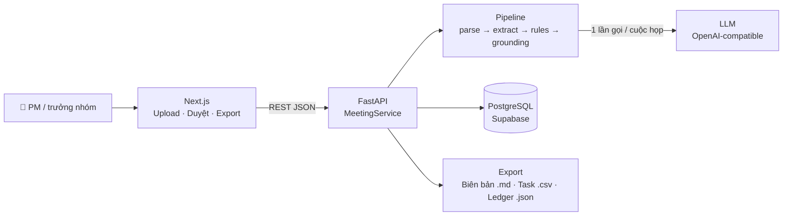
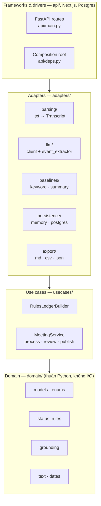
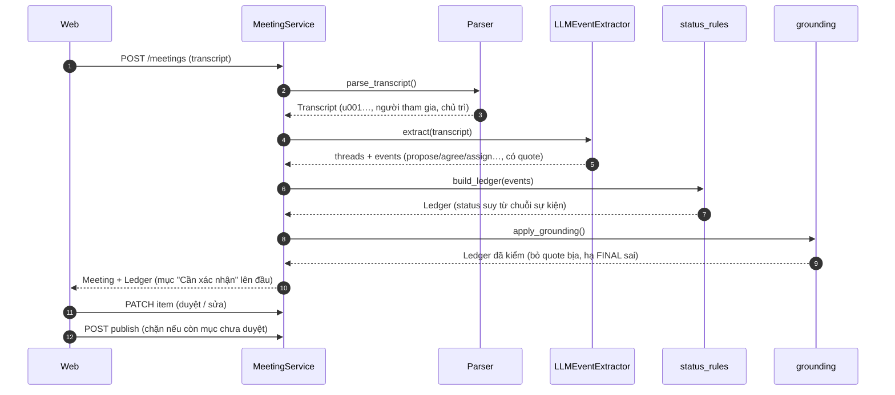
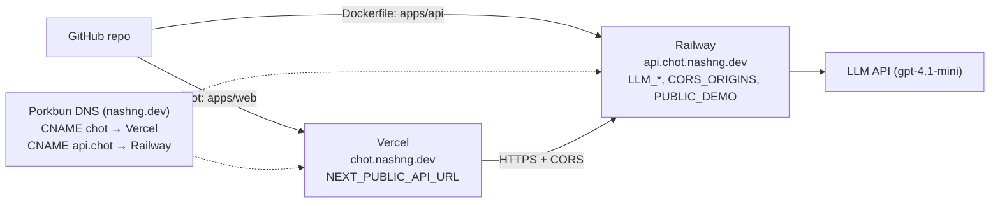

# Kiến trúc — Chốt

> Một câu: **LLM gán nhãn, code quyết định, người duyệt chốt.** Mọi thứ khác là adapter thay được.

## 1. Bức tranh tổng thể

| Thành phần | Công nghệ | Nơi chạy (dev → prod) |
|---|---|---|
| Web | Next.js 16 (App Router), TypeScript, CSS tokens | `npm run dev` → **Vercel** |
| API | FastAPI, Pydantic v2, Python 3.12 | `uvicorn` → **Render / Railway** (Docker) |
| DB | PostgreSQL 16 + pgvector | Docker → **Supabase** |
| LLM | Bất kỳ endpoint OpenAI-compatible | OpenAI / Gemini / OpenRouter → tự host Qwen/Gemma bằng vLLM |
| Eval | Python CLI `chot.eval.run` | Chạy local, không deploy |

## 2. Clean Architecture

**Luật phụ thuộc:** mũi tên chỉ đi vào trong. `domain/` không import gì ngoài stdlib + pydantic. `usecases/` chỉ biết các *port* trong `usecases/ports.py`. Chỉ `api/deps.py` được nối adapter cụ thể vào use case.

**Hệ quả có lợi:** đổi LLM (OpenAI → Qwen tự host) = đổi `.env`; đổi DB = thêm 1 adapter; luật chốt test được không cần mạng (54 test chạy < 1 giây).

## 3. Pipeline xử lý một cuộc họp

| Bước | Ai làm | Vì sao không giao cho LLM / vì sao giao |
|---|---|---|
| Parse | Code | Định dạng cố định, cần ID câu ổn định cho trích dẫn |
| Tách chủ đề + gán sự kiện | **LLM** | Cần hiểu ngữ nghĩa, ngữ dụng tiếng Việt |
| Suy trạng thái cuối | **Code** (`status_rules.py`) | Phải dễ đoán, test được, không đổi khi đổi model — [ADR-0002](adr/0002-llm-labels-code-decides.md) |
| Grounding 2 tầng | **Code** (`grounding.py`) | String match + luật ngữ cảnh, chặn cứng |
| Duyệt | **Người** | Chịu trách nhiệm cuối cùng; dữ liệu sửa = dữ liệu eval |

## 4. Các "builder" (cùng interface `LedgerBuilder`)

| `LEDGER_BUILDER` | Làm gì | Khi nào dùng |
|---|---|---|
| `keyword` | Câu có "chốt/thống nhất/quyết định/đồng ý" → Đã chốt | Baseline để so sánh (cố tình ngây thơ) |
| `summary` (chỉ eval) | 1 prompt "liệt kê quyết định + action items" | Baseline giống đa số tutorial/sản phẩm |
| `replay` | Luật chạy trên sự kiện đã lưu, thiếu thì rơi về keyword | Demo m01–m25 không cần key; sửa luật không tốn token |
| `llm` | LLM gán sự kiện → luật → grounding. Transcript mẫu **nguyên văn** (`demo_events/mXX.txt`) → replay output LLM đã lưu, không gọi LLM | **Pipeline chính** (cả bản demo công khai) |

## 5. API

| Method | Path | Mô tả |
|---|---|---|
| GET | `/health` | Phiên bản + builder đang dùng |
| POST | `/meetings` | `{transcript_text, meeting_id?}` → xử lý và trả Ledger |
| GET | `/meetings` | Danh sách cuộc họp (tắt khi `PUBLIC_DEMO=true`) |
| GET | `/meetings/{id}` | Transcript + Ledger + trạng thái duyệt |
| PATCH | `/meetings/{id}/items/{item_id}` | Sửa `status/owner/deadline/content/decided_by` hoặc `approved` |
| POST | `/meetings/{id}/publish` | 409 nếu còn mục "Cần xác nhận" chưa duyệt |
| GET | `/meetings/{id}/export?format=md\|csv\|json` | Biên bản / task list / ledger |

Mỗi `POST /meetings` tạo record với id ngẫu nhiên (12 ký tự hex), tách khỏi `meeting_id` dùng cho replay. OpenAPI tự sinh tại `http://localhost:8000/docs` (tắt khi `PUBLIC_DEMO=true`).

## 6. Deploy

Bản demo công khai: **https://chot.nashng.dev** (web) · **https://api.chot.nashng.dev** (API). Làm theo từng bước: `bash scripts/deploy_wizard.sh` (chỉ in hướng dẫn + kiểm tra bằng curl/nslookup).

1. **API (Railway):** New Project → Deploy from GitHub repo → Root Directory `apps/api` (Dockerfile, đọc `$PORT`, chạy user không phải root). Variables:

   | Biến | Giá trị |
   |---|---|
   | `LEDGER_BUILDER` | `llm` |
   | `REPLAY_EVENTS_DIR` | `demo_events` |
   | `LLM_API_KEY` / `LLM_MODEL` | key OpenAI / `gpt-4.1-mini` |
   | `MAX_TRANSCRIPT_CHARS` | `20000` |
   | `LLM_RATE_LIMIT_PER_HOUR` / `LLM_GLOBAL_LIMIT_PER_HOUR` | `10` / `60` |
   | `PUBLIC_DEMO` | `true` |
   | `CORS_ORIGINS` | `https://chot.nashng.dev` |

   Custom Domain `api.chot.nashng.dev` → Railway đưa CNAME target.
2. **Web (Vercel):** Import repo, Root Directory `apps/web`. Env `NEXT_PUBLIC_API_URL=https://api.chot.nashng.dev` (nhúng lúc build — đổi thì phải redeploy). Domain `chot.nashng.dev` → Vercel đưa CNAME.
3. **DNS (Porkbun):** thêm 2 CNAME `chot` và `api.chot` theo giá trị ở trên (TTL 600), không sửa bản ghi cũ. SSL do Vercel/Railway tự cấp.

**Không có DB:** API lưu trong RAM (`InMemoryRepository`, tối đa 500 record, cũ nhất bị xoá) → restart/redeploy là mất. Đủ cho demo; `PostgresRepository` + `db/migrations` để dành.

**Giới hạn của bản demo:** transcript ≤ 20.000 ký tự (body ≤ ~120 KB), 10 lượt gọi LLM/giờ/IP và 60 lượt/giờ toàn cục (in-memory, 1 instance — đừng scale ngang khi chưa chuyển sang Redis). Trần chi phí cứng: đặt budget tháng ở OpenAI project.

> **Vì sao API không đặt trên Vercel?** Một cuộc họp 90 phút có thể mất 20–60 giây gọi LLM; serverless function dễ vượt giới hạn thời gian. Khi cần chạy nền: thêm hàng đợi (Inngest / Celery + Redis) như một adapter mới.
>
> **Lưu ý dữ liệu:** Vercel, Railway và LLM API quốc tế đặt server ở nước ngoài → theo Luật 91/2025/QH15 đây là chuyển dữ liệu ra nước ngoài. Chỉ dùng cho demo / pilot có consent. Bán cho khách thật: host tại VN + model tự host (xem [PRD §4](PRD.md#4-quyết-định--rủi-ro)).

## 7. Lộ trình mở rộng — cắm vào đâu?

| Giai đoạn | Thêm gì | Cắm vào | Không phải sửa |
|---|---|---|---|
| **v1 (2–3 ngày)** | Lõi Ledger + eval + màn duyệt | — | — |
| **Pilot** | `PostgresRepository`, đăng nhập (Supabase Auth), chạy nền | `adapters/persistence/postgres.py`, `api/deps.py` | domain, usecases |
| **v2** | Ledger xuyên cuộc họp: `series_id`, việc treo → brief kỳ sau, tìm kiếm pgvector + `bge-m3` | `usecases/brief.py` mới, bảng `meeting_series`, cột `items.embedding` (đã có) | status_rules |
| **v3** | ASR tiếng Việt (PhoWhisper / API trong nước) | `apps/asr/` (service mới) → xuất đúng định dạng transcript | toàn bộ pipeline |
| **v3** | Tích hợp Jira / Sheets / Base.vn | `adapters/export/<tool>.py` | domain |
| **v3** | Model tự host (Qwen3.6-27B / Gemma 4 31B qua vLLM) | `.env` (`LLM_BASE_URL`) | code |

Định dạng transcript là "hợp đồng" giữa ASR và pipeline: bất cứ nguồn nào (upload, ASR, bot) chỉ cần xuất đúng định dạng ở [DATA_DESIGN §1](DATA_DESIGN.md#1-transcript).
