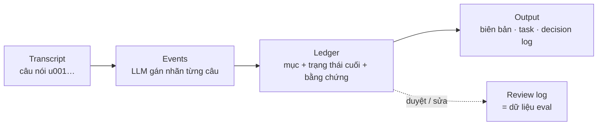
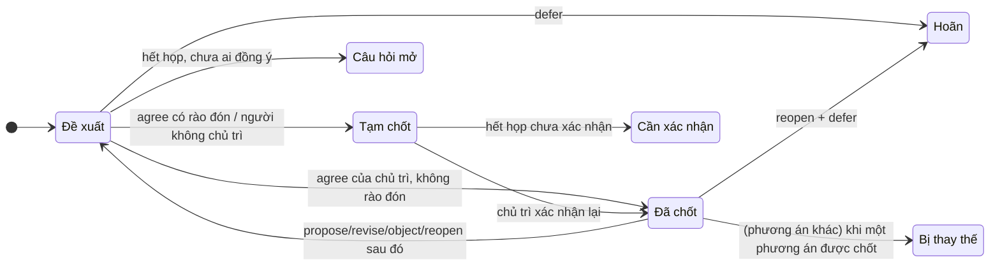
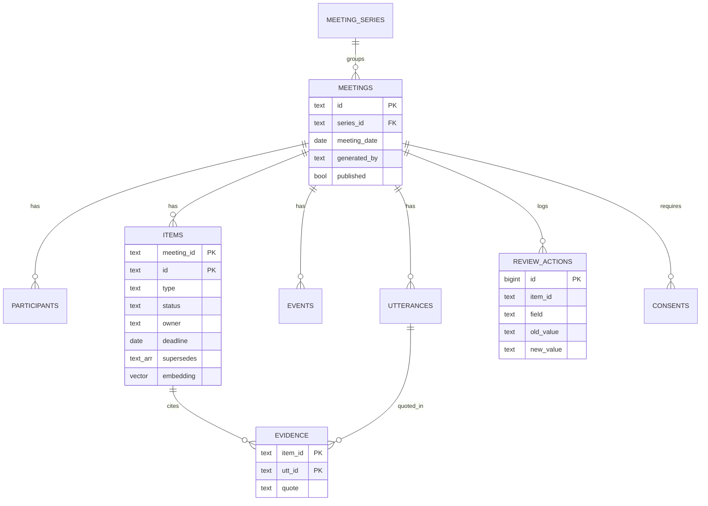

# Thiết kế dữ liệu — Chốt

Ba lớp dữ liệu, đi từ thô đến chín:



## 1. Transcript

Định dạng `.txt` (hợp đồng giữa mọi nguồn đầu vào và pipeline):

```text
# meeting: m01
# title: Weekly sync — App giao hàng
# date: 2026-10-05
# participants: Hùng (CEO, chủ trì); Minh (PM); Lan (Tech lead)
# absent: Phong (Giám đốc)
[00:01:05] Minh: Về thanh toán, em đề xuất mình sử dụng VNPay…
[00:02:30] Lan: Em thấy VNPay phí giao dịch cao hơn…
```

| Trường | Bắt buộc | Ghi chú |
|---|---|---|
| `# meeting` | Không | Thiếu → API tự sinh ID |
| `# date` | Nên có | Cần để đổi "thứ Sáu" thành ngày cụ thể |
| `# participants` | Nên có | `Tên (vai trò, chủ trì)`; **chỉ người có `chủ trì` mới chốt được quyết định** |
| `# absent` | Không | Người vắng — không có quyền chốt trong cuộc họp này |
| `[hh:mm:ss] Tên: câu` | Có | `mm:ss` cũng được. Dòng không có timestamp nối vào câu trước |

Parser gán ID ổn định `u001, u002…` theo thứ tự. Mọi trích dẫn trỏ về ID này.

## 2. Events (output của LLM)

| Nhóm | `kind` | Ý nghĩa | Trường quan trọng |
|---|---|---|---|
| Quyết định | `propose` | Đưa ra phương án | `key` = nhãn phương án |
| | `revise` | Đề xuất thay thế / quay lại phương án cũ | `key` |
| | `object` | Phản đối một phương án | `key` |
| | `agree` | Đồng ý / chốt | `key`, `hedged` |
| | `defer` | Hoãn / chuyển người khác quyết | — |
| | `reopen` | "Thôi khoan" — huỷ đồng thuận trước | — |
| Công việc | `assign` | Giao việc hoặc tự nhận | `owner`, `key`, `deadline_text` |
| | `commit` | Owner xác nhận nhận việc | `key` |
| | `decline` | Owner từ chối / trì hoãn ("để em xem lại") | `key` |
| Khác | `blocker` · `question` · `info` · `request` · `feedback` | Vướng mắc · câu hỏi · tri thức · yêu cầu · phản hồi | — |

Mỗi event: `utt`, `thread`, `speaker`, `content` (diễn đạt lại), `quote` (**nguyên văn**, ngắn nhất), `hedged`. Schema JSON chặt: `adapters/llm/event_extractor.py::EXTRACTION_SCHEMA`.

## 3. Ledger (output của luật)

### 3.1 Loại mục

| `type` | Tiếng Việt | Prefix ID |
|---|---|---|
| `decision` | Quyết định | D |
| `option` | Phương án (không được chọn, giữ làm lịch sử) | O |
| `task` | Công việc | T |
| `blocker` | Vướng mắc | B |
| `open_question` | Câu hỏi mở | Q |
| `knowledge` | Tri thức mới | K |
| `request` | Yêu cầu | R |
| `feedback` | Phản hồi | F |

### 3.2 Trạng thái

| `status` | Hiển thị | Dùng cho |
|---|---|---|
| `final` | Đã chốt | Quyết định đủ 3 điều kiện (dưới) |
| `needs_confirmation` | Cần xác nhận | Tạm chốt chưa xác nhận lại, đồng ý bởi người không chủ trì, đồng ý có rào đón; task chưa ai nhận / owner chưa cam kết |
| `superseded` | Bị thay thế | Phương án khác đã được **chốt** |
| `deferred` | Hoãn | Có `defer` và không có đồng thuận cuối hợp lệ |
| `open` | Đang mở | Task đã nhận, blocker, câu hỏi, tri thức; phương án khi chưa có quyết định cuối |
| `rejected` | Bị bác | Chỉ người duyệt gán thủ công ở v1 |

### 3.3 Luật suy trạng thái (`domain/status_rules.py`)

**Quyết định** — một chủ đề, xét chuỗi event theo thứ tự câu:



`FINAL` ⇔ (1) `agree` cuối cùng của chủ đề do **chủ trì** nói và **không rào đón** · (2) sau nó không có `propose/revise/reopen/defer` hay `object` nhắm vào nó · (3) bằng chứng trỏ đúng câu đó (grounding tầng 2 kiểm lại).

**Công việc:**

| Tình huống | Trạng thái |
|---|---|
| Tự nhận, không rào đón ("em sẽ gửi … cuối tuần") | `open` |
| Được giao + owner `commit` rõ ("Ok anh, thứ Sáu em báo") | `open` |
| Được giao + chỉ "dạ / vâng" | `needs_confirmation` |
| Được giao + "để em xem lại" (`decline`) | `needs_confirmation` |
| Không có owner ("ai đó check giúp") hoặc owner không có trong danh sách | `needs_confirmation`, `owner = null` |

Tín hiệu rào đón (`domain/text.py`): *tạm thời, nếu (mà), hay là, chắc là, có lẽ, thử, để em xem, xem lại, chưa chắc, nghiêng về, thích, hỏi lại…* Backchannel: *dạ, vâng, ừ, ừm, ờ* đứng một mình.

### 3.4 Hạn chót (`domain/dates.py`)

| Nói | Quy ước (họp thứ Hai 05/10/2026) |
|---|---|
| "thứ Sáu", "thứ Sáu này" | Thứ Sáu gần nhất sau ngày họp → 09/10 |
| "thứ Hai" (họp đúng thứ Hai) | Tuần sau → 12/10 |
| "thứ Hai tuần sau" | Thứ Hai của tuần lịch kế tiếp → 12/10 |
| "cuối tuần (này)" | Chủ nhật tuần họp → 11/10 |
| "hôm nay", "chiều nay" / "mai" | 05/10 / 06/10 |
| "15/11" | 15/11/2026 |
| "tuần sau" (không có thứ) | `deadline = null`, giữ `deadline_text`, gắn cờ "hạn chưa cụ thể" |

### 3.5 Ví dụ một mục

```json
{
  "id": "D1", "type": "decision", "thread": "payment-gateway",
  "content": "Launch tháng 11 dùng MoMo; VNPay để phase 2",
  "status": "final", "decided_by": "Hùng", "supersedes": ["O1"],
  "evidence": [
    {"utt": "u019", "ts": "14:20", "speaker": "Hùng", "quote": "Vậy chốt nhé: launch tháng 11 dùng MoMo, VNPay để phase 2"},
    {"utt": "u005", "ts": "03:15", "speaker": "Lan", "quote": "Em đề xuất MoMo"}
  ],
  "flags": ["đã đổi ý trong cuộc họp — xem timeline"]
}
```

### 3.6 Grounding 2 tầng (`domain/grounding.py`)

| Tầng | Kiểm tra | Vi phạm → |
|---|---|---|
| 1 · Có thật | `quote` (chuẩn hoá NFC, chữ thường, khoảng trắng) là chuỗi con của câu `utt` | Bỏ bằng chứng; mục hết bằng chứng → **loại khỏi Ledger** |
| 2 · Đúng ngữ cảnh | `final` phải do chủ trì; bằng chứng mới nhất là câu của người chốt và không rào đón; owner / người quyết phải có trong danh sách | Hạ `final` → `needs_confirmation`, gắn cờ; xoá owner bịa |

## 4. Gold & đánh giá

### 4.1 Định dạng nhãn (`data/gold/<id>.json`)

Giống Ledger nhưng `evidence` chỉ là danh sách mã câu — xem [LABELING_GUIDE](LABELING_GUIDE.md).

```json
{"meeting_id": "m01", "labeler": "nash", "items": [
  {"id": "D1", "type": "decision", "status": "final", "content": "…", "decided_by": "Hùng", "evidence": ["u019"]}
]}
```

### 4.2 Ghép cặp dự đoán ↔ gold

Cùng **nhóm loại** (`decision/option/open_question` · `task` · `blocker` · `knowledge` · `request/feedback`) **và** trùng ít nhất 1 mã câu bằng chứng; chọn cặp trùng nhiều nhất. Không ghép theo chữ vì diễn đạt luôn khác nhau.

### 4.3 Chỉ số (`eval/metrics.py`)

| Chỉ số | Công thức | Mục tiêu |
|---|---|---|
| ⭐ `wrong_final_rate` | quyết định dự đoán `final` mà gold không phải `final` / tổng `final` dự đoán | ≤ 5% |
| `final_state_accuracy` | gold `final` được dự đoán đúng `final` / tổng gold `final` | ≥ 90% |
| `supersession_recall` | gold `superseded` được dự đoán `superseded` | ≥ 80% |
| `owner_accuracy`, `deadline_accuracy` | trên các task ghép được | ≥ 90% / ≥ 85% |
| `grounding_tier1` | quote khớp transcript / tổng quote | 100% |
| `hallucinated_people` | owner/người quyết không có trong danh sách | 0 |
| `item_precision/recall` | mục ghép được / mục dự đoán, / mục gold | theo dõi |

Kết quả hiện tại (05 cuộc họp, `make eval-keyword` / `make eval-oracle`): keyword **chốt nhầm 66,7%**, supersession 0%; luật trên sự kiện chuẩn đạt 100% (chỉ chứng minh luật khớp hướng dẫn gán nhãn, **không** phải chất lượng LLM). Số thật của pipeline LLM: chạy `make eval-llm` và ghi vào [EVAL_LOG](EVAL_LOG.md).

## 5. Database (`db/migrations/001_init.sql`)



- `events` được lưu để **replay**: sửa luật → chạy lại không tốn token.
- `review_actions` append-only: vừa là audit trail, vừa là nguồn dữ liệu eval / (sau này) fine-tune.
- `consents`: tách 3 mục đích theo Luật 91/2025 — `transcript`, `ai_processing`, `knowledge_base`.
- `items.embedding vector(1024)`: để sẵn cho `bge-m3` ở v2, NULL ở v1.

## 6. Quy tắc dữ liệu

- Transcript thật chỉ dùng khi có consent; không commit vào git (`data/runs/` đã ignore).
- **Không** dùng bộ test (`data/raw`, `data/gold`) làm ví dụ trong prompt hay dữ liệu train. Ví dụ trong prompt chỉ lấy từ `data/examples/m00`.
- Sửa schema → sửa đồng thời `domain/models.py`, `apps/web/src/lib/types.ts`, migration SQL và tài liệu này.
