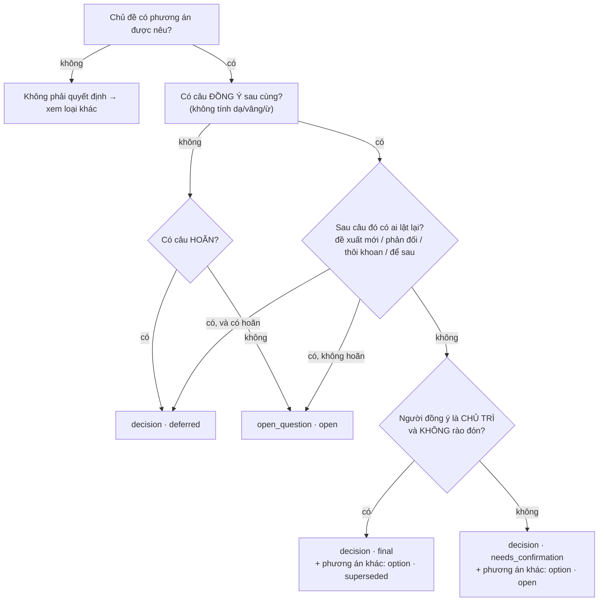

# Hướng dẫn gán nhãn — Chốt

Mục tiêu: với mỗi transcript, viết ra **Ledger đúng** — thứ mà một trưởng nhóm cẩn thận sẽ ghi vào biên bản sau khi họp xong. Nhãn của bạn là "đáp án" để chấm hệ thống, nên quy ước phải nhất quán với luật trong code (`domain/status_rules.py`).

## Quy trình (5 transcript đầu)

1. Đọc mẫu đã gán sẵn: `data/examples/m00.txt` + `m00.gold.json`.
2. Mở `data/raw/m01.txt` và đánh số câu: câu đầu tiên có timestamp là `u001`, tiếp theo `u002`… (hoặc in sẵn bằng lệnh bên dưới).
3. Chép `data/gold/TEMPLATE.json` → `data/gold/m01.json`, điền từng mục.
4. Làm lần lượt m01 → m05. **Chưa mở `data/answer_key/`**.
5. Chạy `make agreement` để so với đáp án. Chỗ lệch = chỗ quy ước còn mơ hồ → thảo luận, sửa hướng dẫn này hoặc sửa nhãn.

In số câu:

```bash
$env:PYTHONUTF8=1; uv run --no-sync --project apps/api python -c "import sys;from chot.adapters.parsing.transcript_txt import parse_transcript_file as p;t=p(sys.argv[1]);[print(u.id,u.speaker+':',u.text) for u in t.utterances]" data/raw/m01.txt
```

## Gán cho cái gì? — mỗi MỤC là 1 dòng biên bản

Không gán **từng câu**, không gán **từng người**. Gán **từng mục**: một thứ cần ghi vào biên bản sau họp (1 quyết định, 1 việc, 1 vướng mắc…).

- Nhiều câu → 1 mục: đề xuất + phản biện + chốt cùng một chủ đề chỉ ra **1** `decision`. Các câu đó vào `evidence`.
- 1 người → nhiều mục: một người có thể nhận 2 việc → 2 `task`.
- Nhiều câu → không mục nào: "Dạ.", "Ừ.", chào hỏi, nêu chương trình họp, chuyển chủ đề, kết thúc họp.
- Tự hỏi: *"Sau họp, có ai cần làm theo hoặc tra lại điều này không?"* Có → 1 mục. Không → bỏ.

### Ví dụ m00 — đi từng câu

| Câu | Nói gì | Thành gì |
|---|---|---|
| u001 | "hôm nay chỉ cần chốt tool quản lý task" | Không gán (chương trình họp). Gợi ý thread `task-tool` |
| u002 | Khoa đề xuất Trello | `evidence` của **O1** (option Trello) |
| u003 | Vy chê Trello (không có bug tracking cho QA) | Theo quy ước bổ sung: phản biện cụ thể → `blocker`. ⚠️ `m00.gold.json` chưa cập nhật (là few-shot của prompt — sửa cùng prompt ở Phase 3) |
| u004 | Khoa đề xuất Jira | `evidence` của **D1** (câu đề xuất gốc) |
| u005 | Thảo: "Ừ." | Không gán (chỉ là đang nghe) |
| u006 | Vy ok Jira | Không gán (Vy không phải chủ trì) |
| u007 | Thảo "chốt dùng Jira… Trello bỏ" | `evidence` của **D1** (câu chốt sau cùng) → D1 `final`, O1 `superseded` |
| u008 + u009 | Thảo giao, Khoa nhận "thứ Tư" | **T1** (1 việc = câu giao + câu nhận) |
| u010 | Vy tự nhận chuyển bug | **T2** |
| u011 | Kết thúc | Không gán |

→ 11 câu, 3 người, nhưng chỉ **4 mục**: D1, O1, T1, T2 (xem `data/examples/m00.gold.json`).

### Ba field hay nhầm

| Field | Là gì | Cách đặt |
|---|---|---|
| `type` | Loại mục | Theo bảng "Quy ước từng loại" bên dưới |
| `id` | Mã mục, duy nhất trong file | Tiền tố theo `type` + số đếm trong file: D=decision, O=option, T=task, B=blocker, Q=open_question, K=knowledge, R=request, F=feedback → `D1, O1, O2, T1, T2…`. Eval **không** dùng id để chấm, chỉ cần không trùng |
| `thread` | Chủ đề = *câu hỏi cuộc họp phải trả lời* ("dùng tool gì?") | Slug tiếng Anh kebab-case (`task-tool`, `payment-gateway`). Chủ đề quay lại giữa họp → **dùng lại slug cũ**. `decision` và các `option` của nó **bắt buộc cùng thread**; mỗi thread tối đa 1 `decision`. Eval không chấm thread |

Eval ghép mục của bạn với mục của hệ thống theo **nhóm loại + câu `evidence` trùng nhau** → `type`, `status`, `evidence` mới là thứ quyết định điểm.

### Thứ tự làm một file
1. In số câu (lệnh ở trên), đọc hết một lượt.
2. Liệt kê các câu hỏi cuộc họp đang trả lời → mỗi câu hỏi 1 thread.
3. Mỗi thread: theo cây dưới đây → 1 `decision` (hoặc `open_question`) + các `option` bị loại.
4. Quét lại từ đầu tìm việc được giao/tự nhận → `task`; vướng mắc → `blocker`; nhận xét → `feedback`; yêu cầu bên ngoài → `request`; sự thật/ràng buộc mới → `knowledge`.
5. Chạy checklist "Tự kiểm" cuối file.

## Quy ước bổ sung (Nash, 14/10/2026)

Rút ra từ `data/gold/m01.json`, áp cho m01–m05. Ưu tiên hơn các mục khác của guide khi mâu thuẫn.

1. Phản biện có nội dung cụ thể (chi phí, thời gian, rủi ro, thiếu nguồn lực) → `blocker`. "Chưa chắc hiệu quả" không tính.
2. Phản biện đồng thời là ràng buộc / số liệu → `blocker` **+** `knowledge`, cùng evidence.
3. Tạm chốt trung gian bị lần chốt cuối thay → `option · superseded`, evidence = câu đề xuất + câu tạm chốt.
4. Đã chốt rồi bị lật thành hoãn → decision `deferred` + mọi phương án `option · open`.
5. Có người trình bày / đề xuất, chủ trì chỉ đồng ý gián tiếp hoặc "Ừ." → `decision · needs_confirmation` (feedback liên quan vẫn giữ).
6. Chủ trì tự quyết rõ, kể cả chen trong câu giao việc ("anh duyệt nâng cấp ổ đĩa") → tách `decision · final`.
7. Evidence của blocker / knowledge / feedback = câu nêu + câu bàn tiếp liên quan.
8. `content` diễn đạt lại ngắn; `labeler` = `"nguyen"` (file Claude soạn chưa duyệt: `"claude"`).
9. Nhắc lại quyết định của họp trước ("như tuần trước đã chốt…") → `knowledge`. Bị lật trong họp này thì mới thành decision mới.
10. Hai người cùng thẩm quyền (cả hai ghi `chủ trì`), chỉ một người chốt, người kia chưa đồng ý → `decision · needs_confirmation`.
11. "Chốt B, nếu … thì quay về A" → B `final`, A `option · open` (chưa bị loại hẳn); điều kiện ghi trong note.
12. Giao việc cho người vắng mặt (có trong `# absent`) → `owner` = người đó, `needs_confirmation`.
13. Hành động tự nhận nằm trong câu rào đón ("chị phải hỏi lại khách") vẫn tách `task · open`.

> ⚠️ Luật trong code (`domain/status_rules.py`) và prompt chưa sinh được các mục theo quy ước 1–6 (`object` không thành blocker; không có option cho tạm chốt; "Ừ." là backchannel). Eval sẽ báo BỎ SÓT các mục này cho tới khi sửa prompt/luật ở Phase 3 (TDD + `make eval-oracle`).

## Cây quyết định cho một chủ đề



## Quy ước từng loại

| Loại | Gán khi | Trạng thái | Bằng chứng (`evidence`) |
|---|---|---|---|
| `decision` | Theo cây trên; **và** khi có người trình bày/đề xuất mà chủ trì chỉ đồng ý gián tiếp hoặc "Ừ." (→ needs_confirmation); **và** khi chủ trì tự quyết rõ dù chen trong câu giao việc (→ final) | final / needs_confirmation / deferred | Câu đồng ý sau cùng (+ câu đề xuất gốc). Với deferred: câu hoãn |
| `option` | Phương án được nêu nhưng không được chọn; **cả lần tạm chốt giữa họp bị lần chốt cuối thay** (kể cả cùng phương án với decision); chủ đề **đã chốt rồi bị lật thành hoãn** → mọi phương án | superseded (nếu có final) / open (nếu needs_confirmation hoặc chốt-rồi-hoãn) | Câu đề xuất (+ câu tạm chốt) |
| `open_question` | Câu hỏi / chủ đề không ai kết luận | open | Câu hỏi + câu phản biện |
| `task` | Có việc cụ thể cần làm | open / needs_confirmation (bảng dưới) | Câu giao + câu trả lời |
| `blocker` | Vướng mắc đang chặn; **và mọi phản biện có nội dung cụ thể** (chi phí, thời gian, rủi ro, thiếu nguồn lực). "Chưa chắc hiệu quả" không tính | open | Câu nêu + câu bàn tiếp cùng vấn đề |
| `knowledge` | Sự thật / ràng buộc mới đáng lưu (số liệu, quy định, môi trường khách). Phản biện chứa số liệu/ràng buộc → gán **cả** blocker lẫn knowledge | open | Câu nêu (+ câu bàn tiếp) |
| `request` | Yêu cầu từ khách / bên ngoài, hoặc đề xuất cải tiến quy trình **chưa được bàn** | open | Câu nêu |
| `feedback` | Nhận xét về sản phẩm / thiết kế / dịch vụ (giữ cả khi đã có decision cho chủ đề đó) | open | Câu nêu (+ câu bàn tiếp) |

### Task

| Câu trả lời của owner | Trạng thái |
|---|---|
| Tự nhận, không rào đón: "Em sẽ gửi media plan cuối tuần này" | `open` |
| "Ok anh, thứ Sáu em báo" | `open` |
| "Dạ vâng." / "Dạ." (chỉ vậy) | `needs_confirmation` |
| "Dạ, để em xem lại ạ" | `needs_confirmation` |
| "Ai đó check giúp…" (không ai nhận) | `needs_confirmation`, `owner: null` |
| "Để chị báo giá lại với khách" (hành động cụ thể, tự làm) | `open` — khác "để em xem lại" |

### Bẫy thường gặp

| Câu | Đúng | Sai thường gặp |
|---|---|---|
| "Ừ." / "Dạ vâng." **trong lúc tranh luận** | Không gán gì | Coi là đồng ý |
| Chủ trì "Ừ." **ngay sau một đề xuất**, không ai bàn tiếp | decision · needs_confirmation | Bỏ qua / final |
| "Thôi **tạm thời** đi MoMo nhé" (rồi không nhắc lại) | needs_confirmation | final |
| "Chị **thích** concept 2 hơn" | needs_confirmation | final |
| "**Nếu** chốt 22/11 thì QA đủ 1 tuần" | Không phải quyết định | final |
| "Mình **chưa chốt được**, để sprint sau" | deferred | final (vì có chữ "chốt") |
| "Ok chốt lẩu mini." → "Ờ **thôi khoan**…" | deferred | final |
| Nhân viên: "Mình chốt đổi … luôn đi anh" | propose (không có thẩm quyền) | final |
| Chốt → bị phản biện → chủ trì "vẫn giữ" | final | needs_confirmation |
| "Gia ra" | Ghi đúng nghĩa "Jira" trong `content` | Bỏ qua mục |

### Hạn chót
Ghi `deadline_text` nguyên văn và `deadline` dạng `YYYY-MM-DD` theo quy ước ở [DATA_DESIGN §3.4](DATA_DESIGN.md#34-hạn-chót-domaindatespy). Không có thứ cụ thể ("tuần sau") → `deadline: null`.

### Tự kiểm trước khi nộp nhãn
- [ ] Mỗi mục có ít nhất 1 mã câu trong `evidence`.
- [ ] `owner` / `decided_by` là tên có trong `# participants`.
- [ ] Không có 2 mục `decision` cho cùng một chủ đề.
- [ ] MỌI mục đều có `note` (bắt buộc, kể cả K/B/R/F): vì sao chọn type/status, nêu số quy tắc; mỗi bẫy trong transcript được ghi rõ.
