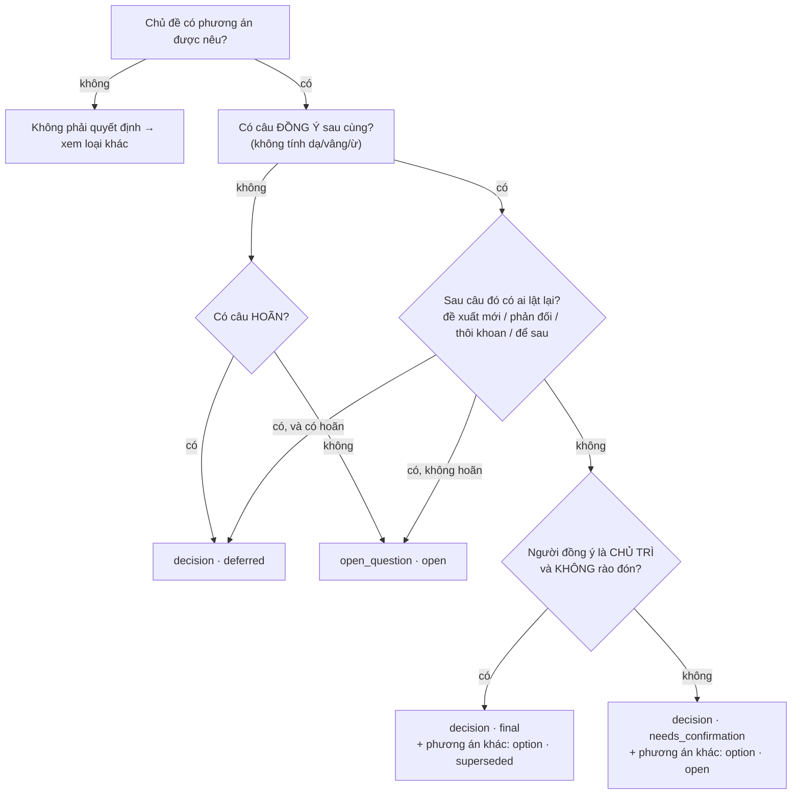

# Hướng dẫn gán nhãn — Chốt

Mục tiêu: với mỗi transcript, viết ra **Ledger đúng** — thứ mà một trưởng nhóm cẩn thận sẽ ghi vào biên bản sau khi họp xong. Nhãn của bạn là "đáp án" để chấm hệ thống, nên quy ước phải nhất quán với luật trong code (`domain/status_rules.py`).

## Quy trình (5 transcript đầu)

1. Đọc mẫu đã gán sẵn: `data/examples/m00.txt` + `m00.gold.json`.
2. Mở `data/raw/m01.txt` và đánh số câu: câu đầu tiên có timestamp là `u001`, tiếp theo `u002`… (hoặc in sẵn bằng lệnh bên dưới).
3. Chép `data/gold/TEMPLATE.json` → `data/gold/m01.json`, điền từng mục.
4. Làm lần lượt m01 → m05. **Chưa mở `data/answer_key/`**.
5. Chạy `make agreement` để so với đáp án. Chỗ lệch = chỗ quy ước còn mơ hồ → thảo luận, sửa hướng dẫn này hoặc sửa nhãn.

In số câu:
```bash
apps/api/.venv/bin/python -c "from chot.adapters.parsing import parse_transcript_file as p; [print(u.id, u.ts_label, u.speaker+':', u.text) for u in p('data/raw/m01.txt').utterances]"
```

## Cây quyết định cho một chủ đề



## Quy ước từng loại

| Loại | Gán khi | Trạng thái | Bằng chứng (`evidence`) |
|---|---|---|---|
| `decision` | Theo cây trên | final / needs_confirmation / deferred | Câu đồng ý sau cùng (+ câu đề xuất gốc). Với deferred: câu hoãn |
| `option` | Phương án được nêu nhưng không được chọn, **chỉ khi chủ đề có decision final hoặc needs_confirmation** | superseded (nếu có final) / open | Câu đề xuất |
| `open_question` | Câu hỏi / chủ đề không ai kết luận | open | Câu hỏi + câu phản biện |
| `task` | Có việc cụ thể cần làm | open / needs_confirmation (bảng dưới) | Câu giao + câu trả lời |
| `blocker` | Vướng mắc đang chặn | open | Câu nêu vướng mắc |
| `knowledge` | Sự thật / ràng buộc mới đáng lưu (số liệu, quy định, môi trường khách) | open | Câu nêu |
| `request` | Yêu cầu từ khách / bên ngoài, hoặc đề xuất cải tiến quy trình **chưa được bàn** | open | Câu nêu |
| `feedback` | Nhận xét về sản phẩm / thiết kế / dịch vụ | open | Câu nêu |

### Task

| Câu trả lời của owner | Trạng thái |
|---|---|
| Tự nhận, không rào đón: "Em sẽ gửi media plan cuối tuần này" | `open` |
| "Ok anh, thứ Sáu em báo" | `open` |
| "Dạ vâng." / "Dạ." (chỉ vậy) | `needs_confirmation` |
| "Dạ, để em xem lại ạ" | `needs_confirmation` |
| "Ai đó check giúp…" (không ai nhận) | `needs_confirmation`, `owner: null` |
| "Để chị báo giá lại với khách" (hành động cụ thể, tự làm) | `open` — khác "để em xem lại" |

### Bẫy thường gặp

| Câu | Đúng | Sai thường gặp |
|---|---|---|
| "Ừ." / "Dạ vâng." | Không gán gì | Coi là đồng ý |
| "Thôi **tạm thời** đi MoMo nhé" (rồi không nhắc lại) | needs_confirmation | final |
| "Chị **thích** concept 2 hơn" | needs_confirmation | final |
| "**Nếu** chốt 22/11 thì QA đủ 1 tuần" | Không phải quyết định | final |
| "Mình **chưa chốt được**, để sprint sau" | deferred | final (vì có chữ "chốt") |
| "Ok chốt lẩu mini." → "Ờ **thôi khoan**…" | deferred | final |
| Nhân viên: "Mình chốt đổi … luôn đi anh" | propose (không có thẩm quyền) | final |
| Chốt → bị phản biện → chủ trì "vẫn giữ" | final | needs_confirmation |
| "Gia ra" | Ghi đúng nghĩa "Jira" trong `content` | Bỏ qua mục |

### Hạn chót
Ghi `deadline_text` nguyên văn và `deadline` dạng `YYYY-MM-DD` theo quy ước ở [DATA_DESIGN §3.4](DATA_DESIGN.md#34-hạn-chót-domaindatespy). Không có thứ cụ thể ("tuần sau") → `deadline: null`.

### Tự kiểm trước khi nộp nhãn
- [ ] Mỗi mục có ít nhất 1 mã câu trong `evidence`.
- [ ] `owner` / `decided_by` là tên có trong `# participants`.
- [ ] Không có 2 mục `decision` cho cùng một chủ đề.
- [ ] Mỗi bẫy trong transcript đã được ghi chú ở `note`.
