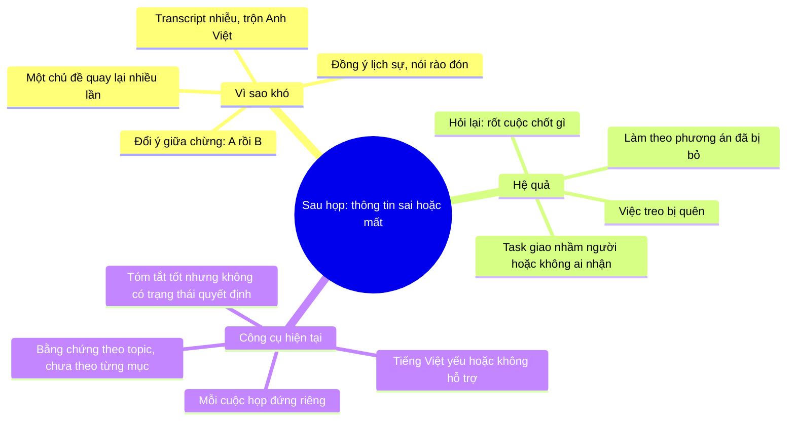
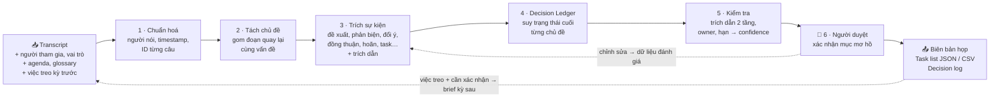
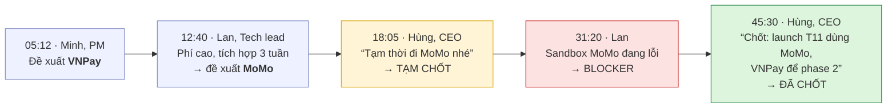
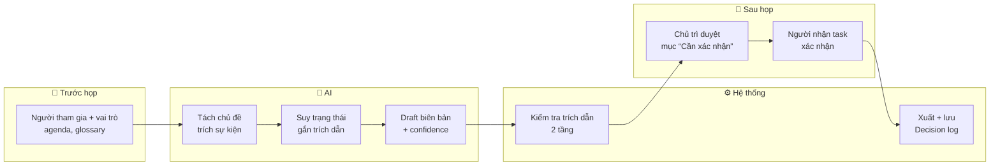
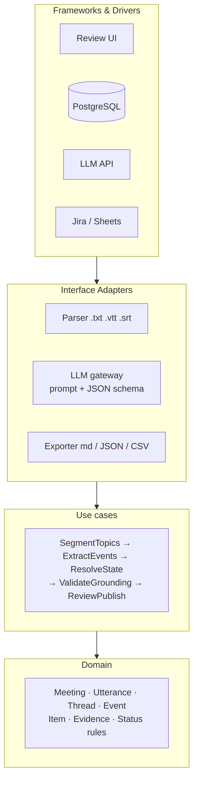
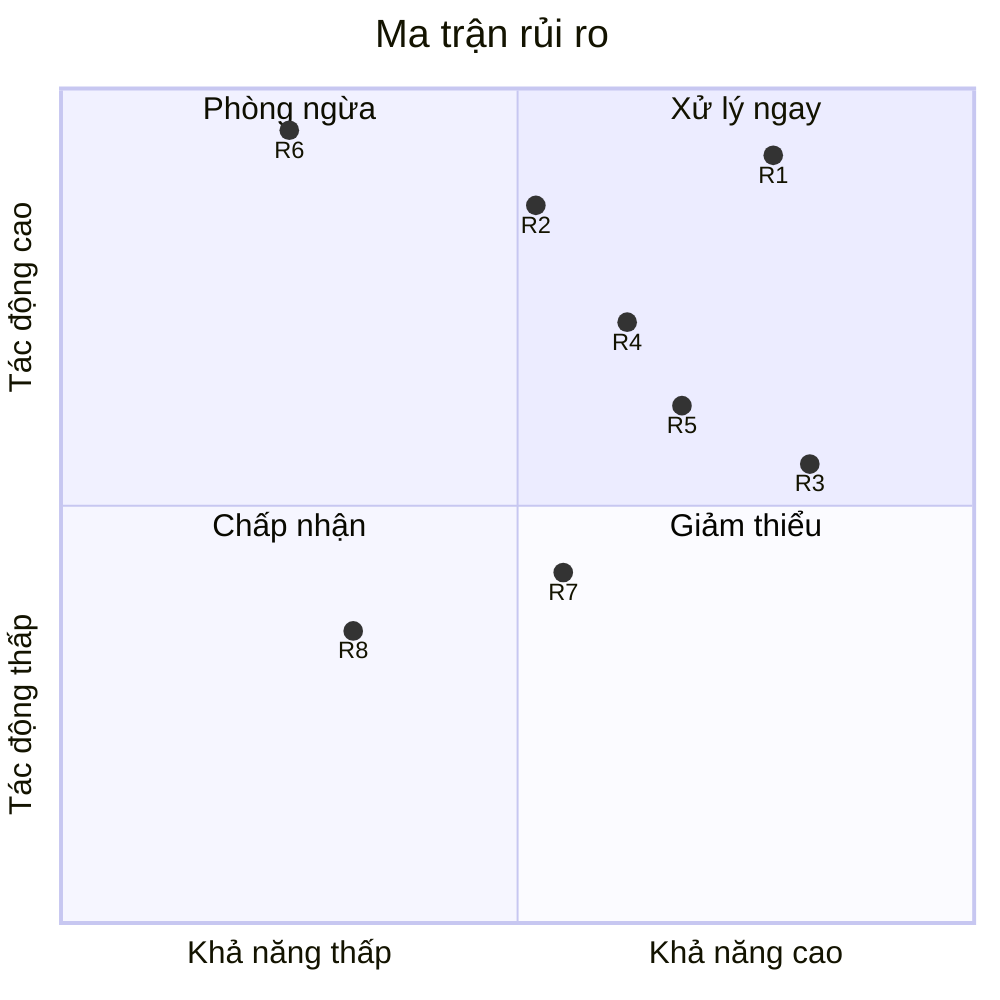
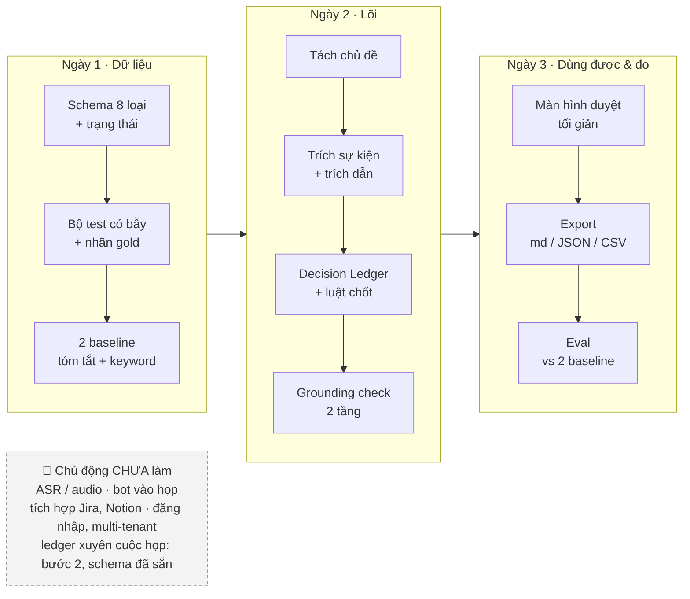
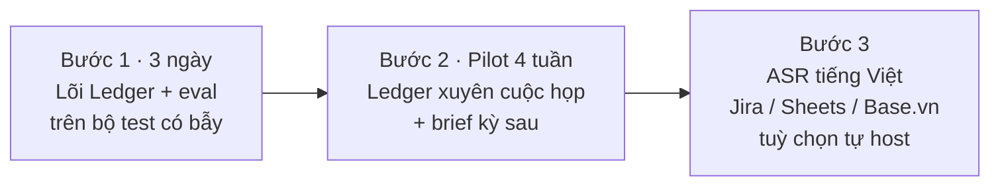
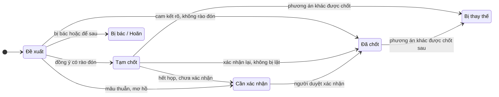

# PRD — “Chốt” (tên tạm): AI biến cuộc họp thành dữ liệu có cấu trúc

> **Mission 1 · Thấu hiểu vấn đề** · Nguyễn Hồ Nguyễn (Nash) · 10/2026 · v2
>
> **Một câu:** Họp xong, cả nhóm biết chính xác **điều gì đã chốt, ai làm gì, hạn nào, điều gì còn treo**. Mỗi dòng đều trỏ về đúng câu nói trong transcript.
>
> Ký hiệu: **[GĐ]** = giả định, cần kiểm chứng · **[n]** = nguồn ở cuối bài.
>
> Tài liệu triển khai: [ARCHITECTURE](ARCHITECTURE.md) · [DATA_DESIGN](DATA_DESIGN.md) · [DESIGN_SYSTEM](DESIGN_SYSTEM.md) · [LABELING_GUIDE](LABELING_GUIDE.md) · [ADR](adr/)

## 0. Trả lời câu hỏi cốt lõi

**Làm thế nào để sau mỗi cuộc họp, thông tin quan trọng được ghi nhận đúng và dùng tiếp được?**

- **Ghi nhận đúng:** không tóm tắt theo dòng thời gian mà dựng *Decision Ledger* theo chủ đề. LLM chỉ gán nhãn từng câu (đề xuất / phản đối / đồng ý / giao việc…); trạng thái cuối do luật trong code suy ra; mục nào cũng phải có trích dẫn khớp transcript, không có thì không xuất; mục không chắc thì "Cần xác nhận" và người chủ trì duyệt.
- **Dùng tiếp được:** mỗi mục là dữ liệu có cấu trúc (JSON) → xuất biên bản, task list cho Sheet/Jira, và việc còn treo được mang sang buổi họp sau.

---

## 1. Vấn đề & người dùng

**Vấn đề thực sự:** không thiếu bản tóm tắt, mà thiếu một bản ghi **đáng tin về trạng thái cuối cùng**. Cuộc họp đi đường vòng (đề xuất → phản biện → đổi ý → chốt), còn biên bản thường kể lại theo đường thẳng.



| | Người dùng | Đau nhất hôm nay | Kết quả thực sự cần |
|---|---|---|---|
| **Chính** | PM / trưởng nhóm chủ trì họp dự án định kỳ | Tự viết biên bản 30–60 phút, đi hỏi lại “chốt A hay B?” [GĐ] | Biên bản đã duyệt + task có chủ & hạn, **< 10 phút** sau họp |
| Phụ | Người tham gia | Không rõ mình nhận việc gì, hạn khi nào | Danh sách việc *của mình* |
| Phụ | Quản lý / người vắng mặt | Không có thời gian xem lại ghi hình | 5 dòng: đã chốt gì, vướng gì |
| Tổ chức | Kho tri thức | Quyết định cũ thất lạc → tranh luận lại | Decision log tra cứu được |

**Bằng chứng nỗi đau (từ review thật):**
- Sai người nói → task giao nhầm người, quyết định gán nhầm người [1][2].
- Câu rào đón (“chắc mình nên…”) → mất owner hoặc deadline [3].
- Văn hoá họp ở VN: nhiều cuộc họp kết thúc bằng đồng ý lịch sự nhưng không có cam kết cụ thể [8].

**Phạm vi MVP:** họp dự án / vận hành định kỳ ở SME Việt Nam · 30–90 phút · 3–10 người · tiếng Việt trộn tiếng Anh.
**Ngoài MVP:** hội thảo, webinar, họp bán hàng (nhiều trình bày, ít quyết định); họp cần biên bản có giá trị pháp lý → giai đoạn sau.

**Thị trường đã có gì:**

| Nhóm | Ví dụ | Đã làm tốt | Khoảng trống (đã kiểm chứng) |
|---|---|---|---|
| Notetaker quốc tế | Otter, Fireflies, Fathom, tl;dv, Granola | Transcript, tóm tắt, action items, link về transcript theo topic | Không có tài liệu chính thức nào về trạng thái quyết định (final / superseded). Fathom không hỗ trợ tiếng Việt [7] |
| **Đối thủ gần nhất** | Fellow | Meeting series, brief trước họp, decisions, action items [6] | Có chuỗi cuộc họp nhưng **không gán trạng thái** cho quyết định |
| Có sẵn trong nền tảng họp | Google Meet, Teams, Zoom | Không cần cài thêm | Meet: notes chỉ 8 ngôn ngữ, **không có tiếng Việt**, không hỗ trợ nhiều ngôn ngữ trong một cuộc họp [4]. Teams recap: dịch 9 ngôn ngữ, không có tiếng Việt [5] |
| Hỗ trợ tiếng Việt | JotMe, One AI, NoteX | Biên bản tiếng Việt, action items | Chủ yếu là tuyên bố marketing; không thấy cơ chế tách đề xuất ↔ quyết định, không thấy trích dẫn từng mục [16] |

→ **Không cạnh tranh ở khâu ghi âm / tóm tắt.** Khác biệt = *đúng trạng thái cuối* + *bằng chứng cho từng mục* + *tiếng Việt*. Về lâu dài: **ledger nối nhiều cuộc họp** (Fellow có chuỗi họp nhưng không có trạng thái).

---

## 2. Giải pháp & luồng hoạt động

**Hướng giải quyết:** không tóm tắt theo dòng thời gian, mà dựng **Decision Ledger** (sổ cái quyết định) **theo chủ đề**. Mỗi chủ đề là một chuỗi sự kiện → trạng thái cuối suy ra từ chuỗi đó → mọi mục phải có trích dẫn.



**Ví dụ thực tế:** họp dự án app giao hàng ngày 07/10, chủ đề *cổng thanh toán*.



**Kết quả hệ thống xuất ra:**

| Loại | Nội dung | Trạng thái | Chủ thể | Bằng chứng |
|---|---|---|---|---|
| Quyết định | Launch T11 dùng MoMo; VNPay sang phase 2 | ✅ Đã chốt | Hùng (CEO) | 45:30 |
| Phương án | Dùng VNPay khi launch | ⛔ Bị thay thế | Minh | 05:12 → 45:30 |
| Task | Kiểm tra lại sandbox MoMo | 🟡 Mở · hạn 09/10 (“thứ Sáu”) | Lan | 45:30 |
| Task | Báo lại phí VNPay cho phase 2 | ❓ Cần xác nhận: Minh mới nói “Dạ, để em xem lại” | Minh | 46:10 |
| Blocker | Sandbox MoMo lỗi | 🟡 Mở | — | 31:20 |

- Câu 18:05 **không** thành quyết định riêng: đó là *tạm chốt*, được xác nhận lại ở 45:30.
- Nếu không có câu 45:30, mục MoMo xuất ra ở trạng thái **Cần xác nhận**, không phải Đã chốt.
- VNPay vẫn được giữ, ở trạng thái *bị thay thế*, làm lịch sử.

Mỗi mục là dữ liệu có cấu trúc, đẩy thẳng được sang công cụ khác:

```json
{
  "id": "D-01", "type": "decision", "thread": "payment-gateway",
  "content": "Launch T11 dùng MoMo; VNPay chuyển sang phase 2",
  "status": "final", "decided_by": "Hùng (CEO)", "supersedes": ["P-01"],
  "evidence": [{ "utt": "u142", "time": "45:30",
                 "quote": "Chốt: launch tháng 11 dùng MoMo, VNPay để phase 2" }],
  "confidence": 0.93
}
```

**8 loại thông tin:** Quyết định · Task · Blocker · Yêu cầu · Feedback · Câu hỏi mở · Tri thức mới · Phương án (lịch sử).

**2 dạng xuất từ cùng một ledger:**
- **Biên bản họp:** thời gian, thành phần, chủ trì, nội dung, kết luận, vấn đề còn tồn đọng (tham khảo mẫu NĐ 30/2020) [15].
- **Task list:** JSON / CSV để đưa vào Sheet hoặc Jira.

---

## 3. AI, dữ liệu & con người



| ✅ AI làm | ⛔ AI không làm |
|---|---|
| Tách chủ đề, phân loại 8 loại thông tin | Bịa quyết định, owner, hạn không có trong nguồn |
| Theo dõi đổi ý, suy trạng thái cuối | Tự phân xử khi mâu thuẫn → đẩy sang “Cần xác nhận” |
| Chuẩn hoá: “anh Minh” → Minh (PM); “thứ Sáu” → 09/10 | Đoán hạn khi không ai nói → để trống + cảnh báo |
| Gắn trích dẫn + timestamp cho mọi mục | Coi “dạ / vâng” là đồng ý; coi “để em xem lại” là đã nhận việc [9][10] |
| Draft biên bản, chấm confidence | Nhận xét thái độ, năng lực của cá nhân |
| Dùng keyword (“chốt”, “thống nhất”) làm **tín hiệu phụ** | Phân loại chỉ bằng keyword: sai với “chưa chốt”, “nếu mà…”, “dạ vâng” lịch sự |
| | Tự gửi biên bản / tạo task khi chưa duyệt |

**Grounding 2 tầng:** không hứa “AI không bao giờ bịa” (lỗi grounding vẫn là vấn đề mở [13]). Cam kết thay thế: *không có bằng chứng hợp lệ thì không xuất*.

| Tầng | Kiểm tra | Ai làm |
|---|---|---|
| 1 · Có thật | Quote khớp đúng transcript (string match). Không khớp → chặn | Hệ thống, tự động |
| 2 · Đúng ngữ cảnh | Quote phải chứng minh đúng loại mục. Ví dụ mục “Đã chốt” phải trích câu đồng thuận **sau cùng** của chủ đề, không phải câu đề xuất | Luật kiểm tra + người duyệt |

| Nhu cầu | MVP | Sau MVP |
|---|---|---|
| Transcript | Upload .txt / .vtt / .srt / .docx | ASR: PhoWhisper, faster-whisper + pyannote, hoặc API trong nước (FPT.AI, Viettel AI) |
| LLM | Claude / GPT / Gemini qua API, structured output (JSON Schema) | Model mở tự host cho khách cần dữ liệu ở lại VN |
| Ngữ cảnh | Người tham gia + vai trò, glossary | Slide, tài liệu dự án (RAG), việc treo kỳ trước |
| Lưu trữ | PostgreSQL (ledger) | + pgvector để tra cứu xuyên cuộc họp |
| Tích hợp | Export md / JSON / CSV | Jira, Trello, Google Sheets, Notion, Base.vn |
| Đánh giá | Bộ test có bẫy 15–20 transcript tiếng Việt tự gán nhãn | AMI, QMSum, MeetingBank làm baseline tiếng Anh [17] |

**Kiến trúc (Clean Architecture):** luật suy trạng thái nằm ở Domain, không phụ thuộc nhà cung cấp LLM → đổi model không ảnh hưởng logic, unit test được.



---

## 4. Quyết định & rủi ro

| # | Chọn | Thay vì | Lý do | Trade-off |
|---|---|---|---|---|
| 1 | Transcript-first | Audio / bot vào họp | Đúng input tối thiểu; tách lỗi ASR khỏi lỗi hiểu; tránh rủi ro consent khi bot tự vào họp [2] | Mất tín hiệu giọng, nói chồng |
| 2 | Pipeline nhiều bước | 1 prompt “tóm tắt” | Truy vết, test từng bước, kiểm soát A→B | Thêm **độ trễ và độ phức tạp**. Chi phí không đáng kể: dưới 1 cent / giờ họp với model mini [14] |
| 3 | **Precision > recall** cho Quyết định | Bắt mọi thứ | Ghi sai quyết định nguy hiểm hơn bỏ sót | Nhiều mục “Cần xác nhận” hơn |
| 4 | Bắt buộc duyệt trước khi publish | Tự động gửi | Xây niềm tin giai đoạn đầu | Thêm ~5 phút |
| 5 | Schema cố định 8 loại | Văn bản tự do | Đẩy sang Jira/Sheet được, đo được | Mất sắc thái → thêm trường “Ghi chú” |
| 6 | LLM cloud qua API + che PII tuỳ chọn | Tự host trong VN ngay | Chất lượng tiếng Việt, tốc độ build | Bị tính là **chuyển dữ liệu ra nước ngoài** → consent theo từng mục đích + hồ sơ đánh giá tác động nộp Bộ Công an trong 60 ngày [11] |



| Rủi ro | Kịch bản thất bại | Giảm thiểu |
|---|---|---|
| **R1** Ý kiến trung gian → quyết định | Ghi VNPay là quyết định vì được nói nhiều nhất | Ledger theo chủ đề + 3 điều kiện chốt (mục 6) |
| **R2** Bịa hoặc trích sai ngữ cảnh | Tự thêm hạn “cuối tuần”; trích câu đề xuất làm bằng chứng cho mục đã chốt | Grounding 2 tầng; không có bằng chứng → không xuất |
| **R3** Lỗi ASR | “MoMo” → “mô mô”, sai tên người | Glossary + danh sách người tham gia |
| **R4** Sai người nói | Task giao nhầm người (lỗi bị phàn nàn nhiều nhất [1][2]) | Đối chiếu danh sách; owner luôn qua người duyệt |
| **R5** Đồng ý lịch sự | “Dạ, để em xem lại” bị ghi thành đã nhận việc | “Dạ / vâng” = đang nghe; câu trì hoãn → Cần xác nhận; người nhận task tự xác nhận [9][10] |
| **R6** Vi phạm dữ liệu cá nhân | Transcript gửi API nước ngoài khi chưa có consent và hồ sơ | Consent tách mục đích (transcript · xử lý AI · lưu kho tri thức); thông báo cho nhân viên; hồ sơ chuyển dữ liệu; che PII; tuỳ chọn tự host [11] |
| **R7** Bỏ qua bước duyệt | Lỗi lan sang Jira | Duyệt ≤ 5 phút: mục confidence thấp hiện trước |
| **R8** Họp dài | Chủ đề phút 5 và phút 80 không nối được | Gom theo chủ đề, không cắt theo thời gian |

**Lưu ý pháp lý (Luật 91/2025/QH15 + NĐ 356/2025, hiệu lực 01/01/2026):** đây là thủ tục nộp hồ sơ, không phải xin phép trước. Miễn trừ cho doanh nghiệp nhỏ **không áp dụng** với bên cung cấp dịch vụ xử lý dữ liệu, nên vendor SaaS vẫn phải tuân thủ [11]. *Không phải tư vấn pháp lý.*

**Rủi ro sản phẩm:** công cụ có sẵn trong Zoom/Teams “đủ dùng” → phải thắng bằng số đo ở mục 5. Quyết định thật được chốt sau họp qua Zalo → giai đoạn sau cho bổ sung thủ công vào ledger.

---

## 5. Kiểm chứng & MVP

**Giải pháp tốt = Đúng → Dùng được → Có giá trị.** (Mục tiêu là đề xuất, chỉnh sau pilot.)

| Tầng | Chỉ số | Mục tiêu |
|---|---|---|
| Đúng | ⭐ **Tỷ lệ chốt nhầm**: ý kiến trung gian bị ghi thành quyết định (north-star) | ≤ 5% |
| Đúng | Độ chính xác trạng thái cuối của quyết định | ≥ 90% |
| Đúng | Phương án cũ được gắn “Bị thay thế” | ≥ 80% |
| Đúng | Precision / Recall: Quyết định & Task | ≥ 0.9 / ≥ 0.8 |
| Đúng | Owner & hạn đúng · owner/hạn bịa | ≥ 90% · 0 |
| Đúng | Trích dẫn khớp transcript (tầng 1) | 100% (chặn cứng) |
| Đúng | Trích dẫn chứng minh đúng nội dung (tầng 2) | ≥ 95% (người chấm) |
| Dùng được | Thời gian hết họp → biên bản đã duyệt | < 10 phút |
| Dùng được | Edit rate (mục bị sửa / xoá khi duyệt) | < 20% |
| Có giá trị | Task hoàn thành đúng hạn; tin nhắn “chốt gì vậy?” sau họp | Tăng / giảm so với trước |

**Cách kiểm chứng:**
1. **Bộ test có bẫy:** 15–20 transcript, gồm 3–5 cuộc họp thật (có consent) + kịch bản đóng vai cài sẵn bẫy: đổi ý A→B, tạm chốt không được xác nhận, “nếu mà…”, “để em xem lại”, “dạ vâng” lịch sự, trộn Anh–Việt, sai tên riêng kiểu lỗi ASR. Gán nhãn gold. Phải tự xây vì AMI / QMSum / MeetingBank không có tiếng Việt và không gán nhãn “bị thay thế” [17].
2. **So với 2 baseline:** (a) 1 prompt tóm tắt, (b) lọc keyword (“chốt”, “thống nhất”). Mục tiêu: chứng minh Ledger giảm tỷ lệ chốt nhầm. “Keyword không đủ” hiện mới là giả thuyết: bằng chứng gián tiếp từ tiếng Anh là mô hình có cấu trúc đạt F 0.58 so với 0.35 của cách gán nhãn phẳng [12].
3. **Phỏng vấn 3–5 trưởng nhóm SME** để kiểm chứng các [GĐ] ở mục 1.
4. **Pilot 4 tuần** (4 kỳ họp định kỳ) với 3–5 team: so thời gian và độ chính xác với biên bản tự viết, thử vòng “việc treo → brief kỳ sau”.

**Kế hoạch 3 ngày:**



**Lộ trình sau 3 ngày:**



---

## 6. Ba câu hỏi bắt buộc

### Q1 · Một vấn đề quan trọng nhất? Người dùng là ai, cần gì?

**Chọn:** ghi đúng **trạng thái cuối** của *quyết định* và *việc cần làm* (ai, làm gì, hạn nào), mỗi mục có bằng chứng.
**Vì sao:** đây là thứ tạo ra hành động sau họp; ghi sai một quyết định hại hơn thiếu một câu tóm tắt. Tóm tắt thì thị trường đã làm tốt, nhưng chưa công cụ nào gán trạng thái cho quyết định, và lỗi người dùng phàn nàn nhiều nhất là sai owner, mất hạn.
**Người dùng:** PM / trưởng nhóm chủ trì họp dự án định kỳ ở SME Việt Nam.
**Kết quả cần:** trong 10 phút sau họp có biên bản đã duyệt gồm quyết định cuối, task có chủ và hạn, việc còn treo. Gửi đi được ngay, không phải hỏi lại “rốt cuộc chốt gì”.

### Q2 · Chỉ có 3 ngày: làm gì trước, chủ động chưa làm gì?

**Làm trước lõi suy luận**, vì đó vừa là rủi ro lớn nhất vừa là khác biệt duy nhất. Ngày 1: schema, bộ test có bẫy, hai baseline (tóm tắt, keyword). Ngày 2: pipeline chủ đề → sự kiện → Decision Ledger, bắt buộc trích dẫn. Ngày 3: màn hình duyệt tối giản, xuất md/JSON/CSV, eval so với baseline.
**Chủ động chưa làm:** ASR/audio, bot vào họp, tích hợp Jira/Notion, đăng nhập. Ledger xuyên cuộc họp là bước 2: schema đã có `thread` và `supersedes` nhưng chưa build.
**Vì sao:** các phần kia thị trường đã có hoặc phụ thuộc vào lõi. Lõi sai thì mọi thứ phía sau cũng sai, chỉ sai nhanh hơn.

### Q3 · Một vấn đề đổi nhiều lần: làm sao không biến ý kiến trung gian thành quyết định?

Không trích từng câu riêng lẻ. Mỗi vấn đề là **một chuỗi sự kiện**: đề xuất → phản biện → đổi ý → đồng thuận / hoãn. Một mục chỉ là **“Đã chốt”** khi đủ 3 điều kiện: (1) có cam kết **không rào đón** từ người có thẩm quyền (“tạm thời”, “nếu mà”, “dạ” không tính); (2) không có sự kiện nào sau đó lật lại; (3) trích dẫn đúng câu đồng thuận sau cùng. Phương án cũ được giữ ở trạng thái **“Bị thay thế”**. Tạm chốt chưa được xác nhận lại, hoặc mâu thuẫn → **“Cần xác nhận”**, người chủ trì quyết. Đo bằng tỷ lệ chốt nhầm trên bộ test có bẫy, mục tiêu ≤ 5%.



---

## Nguồn tham khảo

1. G2 — *Otter.ai Pros and Cons* — https://www.g2.com/products/otter-ai/reviews?qs=pros-and-cons (truy cập 10/2026)
2. eesel AI — *The 2026 Otter AI reviews: An honest look at its pros and cons* — https://www.eesel.ai/blog/otter-ai-reviews (2026)
3. AI Flow Review — *Otter AI Review 2026: Speaker ID and Action Items* — https://aiflowreview.com/otter-ai-speaker-diarization-action-items/ (2026)
4. Google Meet Help — *“Take notes for me” in Google Meet* — https://support.google.com/meet/answer/14754931 (truy cập 10/2026)
5. Microsoft Learn — *Intelligent recap for calls and meetings* — https://learn.microsoft.com/en-us/microsoftteams/intelligent-recap-calls-meetings (truy cập 10/2026)
6. Fellow Help Center — *Fellow Glossary* — https://help.fellow.ai/en/articles/2477293-fellow-glossary (truy cập 10/2026)
7. Fathom — *How Fathom Works* — https://www.fathom.ai/overview (truy cập 10/2026)
8. Source of Asia — *Vietnam Business Culture: A practical guide for foreigners* — https://www.sourceofasia.com/business-culture-in-vietnam-101-a-guide-for-foreigners/ (2026)
9. *Expressions of indirect refusal in Vietnamese (compared with Russian)* — https://www.researchgate.net/publication/352100279_Expressions_of_indirect_refusal_in_Vietnamese_compared_with_Russian
10. *CCBench: Assessing LLM Cultural Competence via Implicitly Signaled Norms* — https://arxiv.org/pdf/2607.05405 (07/2026)
11. Future of Privacy Forum — *Making Sense of Vietnam’s Latest Data Protection and Governance Regime* — https://fpf.org/wp-content/uploads/2026/01/January-2026-FPF-Issue-Brief-Making-Sense-of-Vietnams-Latest-Data-Protection-and-Governance-Regime-1.pdf (01/2026)
12. Fernández et al. — *Modelling and Detecting Decisions in Multi-party Dialogue* (SIGdial 2008) — https://aclanthology.org/W08-0125.pdf
13. *Evaluation-as-Search: Adaptive Discovery of Grounding Failures in Meeting Assistants* — https://arxiv.org/pdf/2608.20392 (08/2026)
14. OpenAI — *GPT-5 mini* (bảng giá model) — https://platform.openai.com/docs/models/gpt-5-mini (truy cập 10/2026)
15. LuatVietnam — *Biểu mẫu văn bản hành chính theo Nghị định 30/2020* — https://luatvietnam.vn/bieu-mau/bieu-mau-van-ban-hanh-chinh-571-27528-article.html
16. JotMe — *Vietnamese AI Meeting Notes* — https://www.jotme.io/tools1/ai-meeting-notes/vietnamese · VietnamNet — *NoteX AI* — https://vietnamnet.vn/notex-ai-tro-ly-cuoc-hop-thong-minh-cho-doanh-nghiep-2490608.html
17. Datasets: AMI Meeting Corpus · QMSum — https://arxiv.org/pdf/2104.05938 (2021) · MeetingBank — https://arxiv.org/abs/2305.17529 (2023)

Tham khảo thêm: GADR — *Gathering Architecture Decision Records from Meeting Transcriptions* — https://arxiv.org/pdf/2608.17694 (08/2026): LLM từng biến thảo luận tạm thời thành quyết định đã chấp nhận, đúng lỗi R1 mà Ledger nhắm tới.
